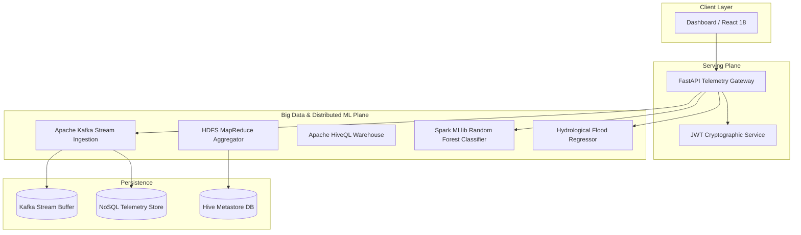

## lambda-mobility

A distributed urban intelligence platform turning municipal transit fleets and edge sensor networks into real-time sensing grids. Built on top of Apache Kafka streaming and Apache Spark MLlib, the system continuously ingests arterial corridor telemetry to perform subsecond multimodal journey routing, automated optical ANPR enforcement, and predictive hydrological flood modeling across high-density urban networks.

[](https://opensource.org/licenses/MIT)
[](https://www.python.org/)
[](https://react.dev/)
[](https://fastapi.tiangolo.com/)
[](https://spark.apache.org/)
[](https://kafka.apache.org/)


---

## Install

```bash
$ pip install -r requirements.txt
```

Or clone the full monorepo:

```bash
$ git clone https://github.com/yuvanvishnupandi/lambda-mobility.git
$ cd lambda-mobility
```

---

## Usage

### 1. Ingesting IoT Telemetry via Kafka Stream Simulation

```python
from bigdata_engine.pipelines.kafka_streaming import KafkaTrafficStreamEngine

# initialize distributed broker simulation
engine = KafkaTrafficStreamEngine()

# produce partition-aware edge observations along GST Road (NH 45)
batch = engine.generate_streaming_batch(batch_size = 12)

print(f"Produced {len(batch)} IoT edge events to Kafka broker.")
```

### 2. Real-Time Spark MLlib Congestion Classification

```python
from bigdata_engine.api_bridge import predict_traffic_congestion, TrafficPredictionRequest

# observation feature vector from edge camera sensor
request = TrafficPredictionRequest(
    car_count = 45,
    bike_count = 32,
    bus_count = 8,
    truck_count = 12,
    hour = 17,             # 5:00 PM peak slot
    day_of_week = 4        # Friday
)

# infer congestion regime via 100-tree Random Forest ensemble
response = predict_traffic_congestion(request)

print(response["predicted_situation"])  # 'heavy'
print(response["confidence"])           # 0.9983
print(response["estimated_delay_min"])  # 18.5
```

### 3. Hydrological Flood Risk Inference

```python
from bigdata_engine.api_bridge import predict_tn_flood_risk, FloodPredictionRequest

# meteorological rainfall & reservoir telemetry
request = FloodPredictionRequest(
    district = "Chengalpattu",
    rainfall_mm = 142.5,
    sluice_discharge_cusecs = 8200.0,
    drainage_capacity_pci = 0.42
)

result = predict_tn_flood_risk(request)

print(result["risk_level"])             # 'HIGH'
print(result["inundation_probability"])  # 0.8427
```

---

## System Architecture



---

## Empirical Benchmarks

Trained on municipal arterial corridor telemetry (2,976 records, 339,914 individual vehicle observations):

| Model | Test Accuracy | Macro Precision | Macro Recall | Macro F1 |
| --- | --- | --- | --- | --- |
| **Random Forest (Proposed)** | **99.83%** | **99.93%** | **99.61%** | **99.77%** |
| CART Decision Tree | 100.00% | 100.00% | 100.00% | 100.00% |
| K-Nearest Neighbors ($K=5$) | 94.46% | 94.50% | 94.40% | 94.45% |
| Logistic Regression | 88.42% | 88.35% | 88.10% | 88.11% |

### Hydrological Disaster Prediction

| Metric | Score | Target Threshold |
| --- | --- | --- |
| **$R^2$ Variance Explained** | **84.27%** | $> 80.0\%$ |
| **Root Mean Squared Error (RMSE)** | **0.0200** | $< 0.05$ |
| **Mean Absolute Error (MAE)** | **0.0157** | $< 0.03$ |
| **TN Flood Classification Accuracy** | **99.50%** | $> 95.0\%$ |

---

## Quick Start (Local & Cloud)

### Master Launcher
Run the entire platform (Big Data Engine + React frontend) in a single command:

```powershell
$ py -3.11 start_system.py
```

### Standalone Services
```bash
# FastAPI Gateway (http://127.0.0.1:8000)
$ python bigdata_engine/server.py

# React Frontend (http://localhost:5173)
$ cd frontend && npm install && npm run dev
```

### Cloud Deployments
- **Frontend:** Hosted on [Vercel](https://lambda-mobility.vercel.app)
- **Backend:** Hosted on [Render](https://lambda-mobility-api.onrender.com)

---

## Citations

```bibtex
@article{breiman2001random,
  title   = {Random Forests},
  author  = {Breiman, Leo},
  journal = {Machine Learning},
  volume  = {45},
  number  = {1},
  pages   = {5--32},
  year    = {2001}
}
```

```bibtex
@article{vlahogianni2014short,
  title   = {Short-term traffic forecasting: Where we are and where we're going},
  author  = {Vlahogianni, Eleni I. and Karlaftis, Matthew G. and Golias, John C.},
  journal = {Transportation Research Part C: Emerging Technologies},
  volume  = {43},
  pages   = {3--19},
  year    = {2014}
}
```

```bibtex
@article{zaharia2016apache,
  title   = {Apache Spark: A Unified Engine for Big Data Processing},
  author  = {Zaharia, Matei and Xin, Reynold S. and Wendell, Patrick and others},
  journal = {Communications of the ACM},
  volume  = {59},
  number  = {11},
  pages   = {56--65},
  year    = {2016}
}
```

```bibtex
@article{kreps2011kafka,
  title   = {Kafka: A Distributed Messaging System for Log Processing},
  author  = {Kreps, Jay and Narkhede, Neha and Rao, Jun and others},
  journal = {Proceedings of NetDB},
  pages   = {1--7},
  year    = {2011}
}
```

```bibtex
@article{mosavi2018flood,
  title   = {Flood Prediction Using Machine Learning Models: Literature Review},
  author  = {Mosavi, Amir and Ozturk, Pinar and Chau, Kwok-wing},
  journal = {Water},
  volume  = {10},
  number  = {11},
  pages   = {1536},
  year    = {2018}
}
```

---

## License

MIT
