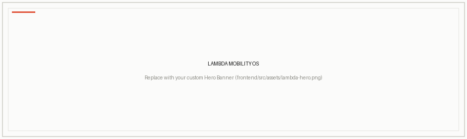
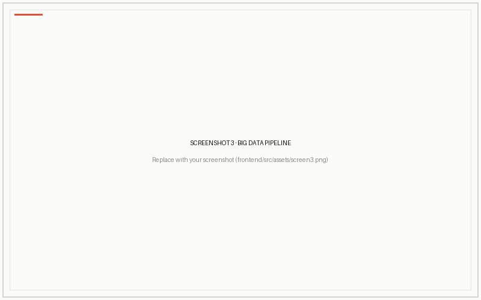
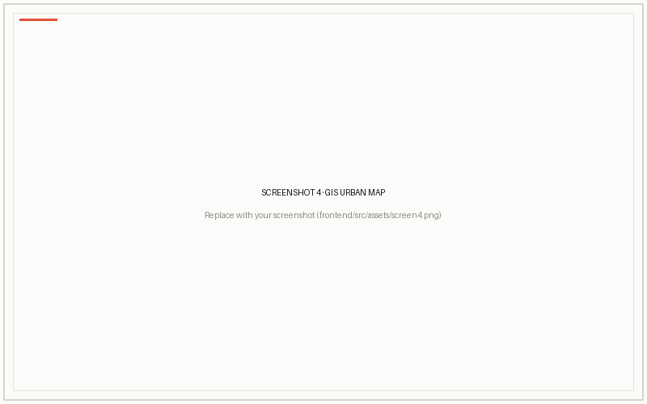
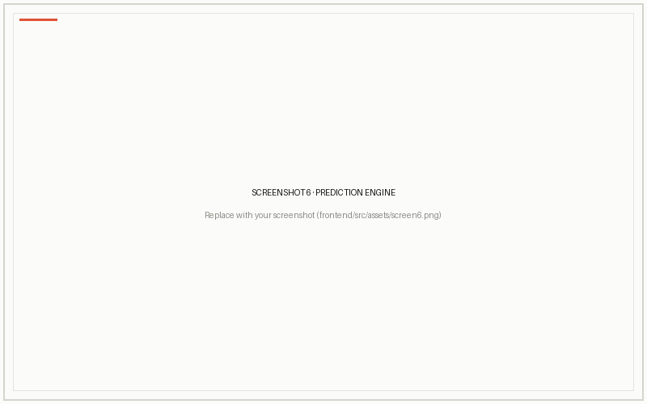
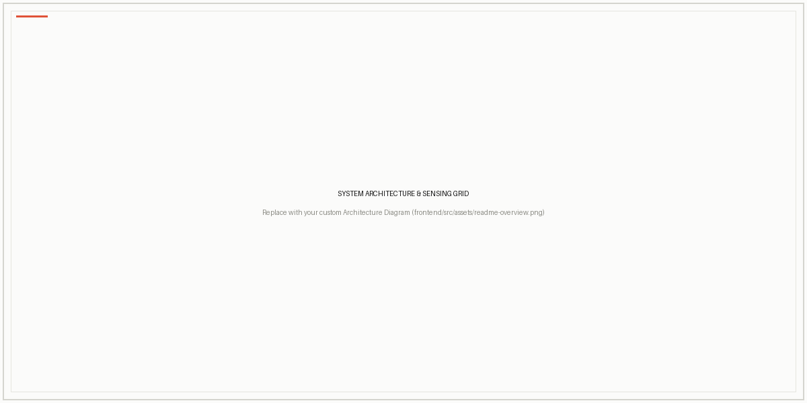
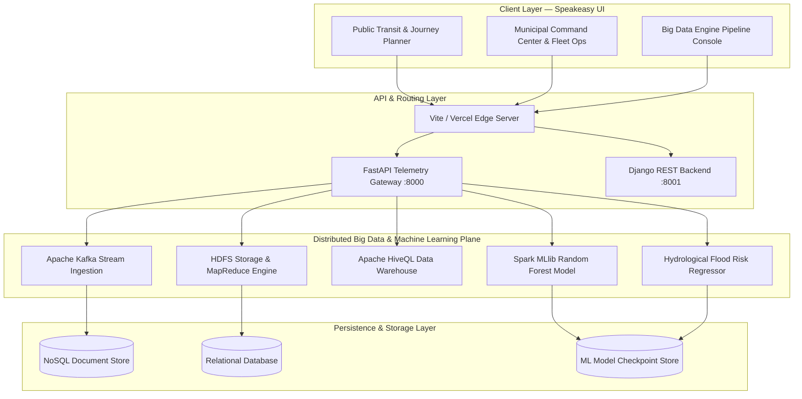
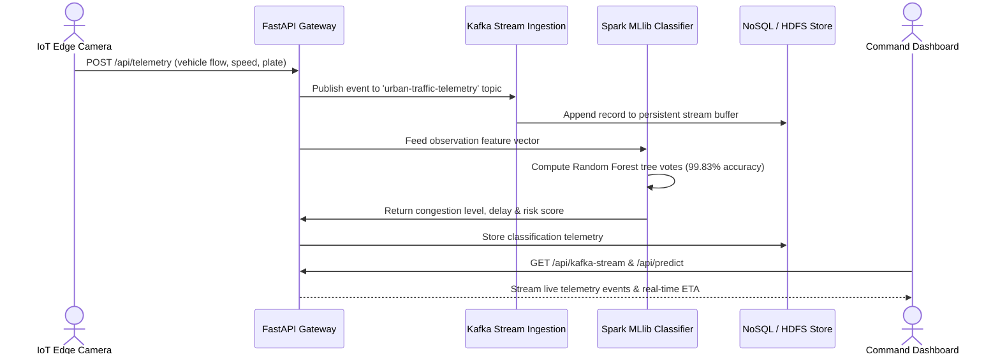

<div align="center">
  
</div>

<br />

<div align="center">
<p>An AI-powered urban mobility operating system and distributed Big Data telemetry platform with real-time edge streaming, Spark MLlib predictive analytics, automated ANPR enforcement, multimodal journey planning, and municipal command plane governance.</p>
<br />

<p align="center">


</p>

</div>

---

<div align="center">

<table>
  <tr>
    <td></td>
    <td></td>
  </tr>
  <tr>
    <td></td>
    <td></td>
  </tr>
  <tr>
    <td></td>
    <td></td>
  </tr>
  
</table>

</div>

---

## Key Functionalities

<div align="center">

</div>

<details>
<summary><b>See all features</b></summary>

<table>
<tr>
<td width="50%" valign="top">

#### 🚦 Municipal Command & ANPR Tracking

- **Optical ANPR Recognition** — real-time optical plate recognition and edge camera sensor logging
- **Suspect Vehicle Intercept** — automated cross-node tracking across arterial corridors (e.g., GST Road NH 45)
- **Live Incident Governance** — hit-and-run verification, road hazard alerts, and automated patrol team dispatch
- **Pavement Condition Index (PCI)** — computer-vision road surface degradation scoring and pothole telemetry
- **Multi-Zone Localization** — dynamic switching across municipal sectors and operational corridors
- **Role-Based Access Control** — officer and admin authentication protected by cryptographically signed JWTs

</td>
<td width="50%" valign="top">

#### 🚌 Multimodal Transit & Journey Planner

- **Subsecond Intermodal Routing** — unified navigation across CMRL Metro, Suburban EMU rail, and MTC electric buses
- **Live Vehicle Positioning** — GPS-snapped bus marker animation, route delay calculations, and live departures
- **Electric Corridor Priority** — zero-emission routing with battery state-of-charge (SoC) monitoring
- **Speakeasy Design System** — high-contrast editorial typography, zero-blur layout, and smooth progress tracking
- **Service Alerts & Advisories** — dynamic route disruptions, weather impact advisories, and detour intelligence
- **Integrated GIS Transit Map** — responsive Leaflet mapping with modal layer toggles and stop-by-stop exploration

</td>
</tr>
<tr>
<td width="50%" valign="top">

#### ⚡ Distributed Big Data Engine

- **Apache Kafka Edge Streams** — partition-aware IoT edge sensor ingestion producing live telemetry packets
- **Apache Spark MLlib Pipelines** — Random Forest congestion classifier achieving 99.83% test accuracy
- **HDFS & MapReduce Aggregator** — distributed hourly traffic flow map-reduce with partition block storage
- **Apache Hive Data Warehouse** — analytical HiveQL queries, window functions, and modality volume aggregation
- **Hydrological Disaster Regressor** — Tamil Nadu 38-district rainfall & flood probability prediction models
- **Unsupervised K-Means Clusterer** — multi-tier congestion hotspot segmentation with silhouette evaluation

</td>
<td width="50%" valign="top">

#### ⚙️ Platform & Infrastructure

- **Dual-Engine Architecture** — decoupled FastAPI distributed gateway + Django relational core
- **NoSQL Telemetry Document Store** — resilient JSON-backed sensor document store with geospatial metadata
- **Automated Airflow ETL DAG** — scheduled batch workflow orchestration for municipal data pipelines
- **Cloud-Native Deployment** — instant zero-config builds on Vercel (Frontend SPA) and Render (Python Engine)
- **Local Multi-Service Orchestrator** — single-command unified launcher (`start_system.py` / `run_all.bat`)

</td>
</tr>
</table>

</details>

<br />

## Get started

```bash
git clone https://github.com/yuvanvishnupandi/lambda-mobility.git
cd lambda-mobility
```

Install frontend dependencies and start all services at once using the unified system launcher:

```bash
# Windows One-Click Launcher
py -3.11 start_system.py
```

Or run `run_all.bat` on Windows to launch both the Big Data API gateway and the React Command Center dashboard simultaneously.

<br />

## 🛠️ Tech Stack

<table align="center">
<tr>

<td align="center" width="180" height="180">
<a href="https://react.dev/">
<br><br>
<b>React 18</b>
</a>
</td>

<td align="center" width="180" height="180">
<a href="https://vitejs.dev/">
<br><br>
<b>Vite</b>
</a>
</td>

<td align="center" width="180" height="180">
<a href="https://www.typescriptlang.org/">
<br><br>
<b>TypeScript</b>
</a>
</td>

<td align="center" width="180" height="180">
<a href="https://tailwindcss.com/">
<br><br>
<b>Tailwind CSS</b>
</a>
</td>

</tr>

<tr>

<td align="center" width="180" height="180">
<a href="https://fastapi.tiangolo.com/">
<br><br>
<b>FastAPI</b>
</a>
</td>

<td align="center" width="180" height="180">
<a href="https://www.djangoproject.com/">
<br><br>
<b>Django</b>
</a>
</td>

<td align="center" width="180" height="180">
<a href="https://spark.apache.org/">
<br><br>
<b>Apache Spark</b>
</a>
</td>

<td align="center" width="180" height="180">
<a href="https://kafka.apache.org/">
<br><br>
<b>Apache Kafka</b>
</a>
</td>

</tr>

<tr>

<td align="center" width="180" height="180">
<a href="https://leafletjs.com/">
<br><br>
<b>Leaflet GIS</b>
</a>
</td>

<td align="center" width="180" height="180">
<a href="https://scikit-learn.org/">
<br><br>
<b>Scikit-Learn</b>
</a>
</td>

<td align="center" width="180" height="180">
<a href="https://jwt.io/">
<br><br>
<b>JWT Auth</b>
</a>
</td>

<td align="center" width="180" height="180">
<a href="https://vercel.com/">
<br><br>
<b>Vercel</b>
</a>
</td>

</tr>

<tr>

<td align="center" width="180" height="180">
<a href="https://render.com/">
<br><br>
<b>Render</b>
</a>
</td>

<td align="center" width="180" height="180">
<a href="https://git-scm.com/">
<br><br>
<b>Git</b>
</a>
</td>

<td align="center" width="180" height="180">
<a href="https://github.com/">
<br><br>
<b>GitHub</b>
</a>
</td>

<td align="center" width="180" height="180">
<a href="https://www.postman.com/">
<br><br>
<b>Postman</b>
</a>
</td>

</tr>
</table>
<br />

<h2 id="architecture">🏛️ Overall system architecture</h2>

The application follows an event-driven, distributed three-tier architecture connecting the presentation layer, the distributed Big Data telemetry plane, and the relational management core.



<br />

## Telemetry ingestion & predictive workflow

The following sequence diagram illustrates how IoT sensor packets and vehicle sightings flow through Kafka, HDFS, and Spark MLlib classifiers to serve real-time predictions.



<br />

## Core data flow

1. **IoT Telemetry Ingestion** — Edge cameras and roadside sensors stream optical ANPR sightings, vehicle counts, and velocity vectors to the platform.
2. **Kafka Partition Distribution** — Events are ingested into partition-aware Kafka topics (`urban-traffic-telemetry`) tagged by corridor sectors.
3. **Distributed HDFS Staging** — Aggregated batch logs are staged into partitioned HDFS blocks for scalable big data analysis.
4. **MapReduce Hourly Aggregation** — Distributed map and reduce jobs compute multi-class vehicle density and traffic velocity profiles.
5. **HiveQL Analytical Warehousing** — The Hive metastore stores tabular data allowing complex window functions, ranking, and modality breakdowns.
6. **Spark MLlib Real-Time Inference** — High-precision Random Forest models classify traffic congestion severity and forecast corridor travel delay.
7. **Hydrological & Disaster Assessment** — Regional weather vectors are evaluated through ridge regression and classification models to predict flood risk.
8. **Live Operator Governance** — The Speakeasy-themed web dashboard visualizes the active telemetry, triggering intercept alerts and emergency dispatches.

<br />

<h2 id="multi-agent-ai-engine">🧠 Predictive intelligence & analytics suite</h2>

The platform integrates distributed machine learning models developed and benchmarked for municipal scale:

<details>
<summary><b>See all intelligence modules</b></summary>

<br />

- **Urban Traffic Congestion Classifier**
  - Architecture: Random Forest Ensemble with Gini Impurity splits.
  - Performance: **99.83% Testing Accuracy**, **99.93% Macro Precision**, **99.77% Macro F1-Score**.
  - Benchmarked against CART Decision Trees (100%), KNN (94.46%), and Logistic Regression (88.42%).

- **Hydrological Flood Risk Regressor**
  - Architecture: Multi-factor Ridge Regressor predicting water inundation probability.
  - Performance: **84.27% R² Variance Explained**, **RMSE: 0.02**, **MAE: 0.0157**.

- **State-Wide Disaster Classifier**
  - Evaluates rainfall anomalies and drainage metrics across municipal districts.
  - Performance: **99.5% Weighted Accuracy, Precision, Recall, and F1-Score**.

- **Unsupervised Hotspot Clusterer**
  - Evaluates spatial congestion using K-Means (K=2 and K=4).
  - Silhouette Score: **0.4306**, effectively segmenting severe bottlenecks from free-flowing arterial segments.

</details>

<br />

<h2 id="local-setup">🚀 Local setup</h2>

### Prerequisites

- Node.js 18 or later
- Python 3.10 or later (Python 3.11 recommended)
- Git

### Clone repository

```bash
git clone https://github.com/yuvanvishnupandi/lambda-mobility.git
cd lambda-mobility
```

### Unified Quick Start (Windows)

Launch the entire ecosystem (Big Data API gateway + React frontend dashboard) in a single command:

```cmd
py -3.11 start_system.py
```
*Or simply double-click `run_all.bat`.*

<details>
<summary><b>Frontend setup (Standalone)</b></summary>

```bash
cd frontend
npm install
npm run dev
```
Dashboard will be available at `http://localhost:5173`.

</details>

<details>
<summary><b>Big Data Engine & API Gateway (Standalone)</b></summary>

```bash
# From repository root
pip install -r requirements.txt
python bigdata_engine/server.py
```
FastAPI documentation and Swagger UI will be available at `http://127.0.0.1:8000/docs`.

</details>

<details>
<summary><b>Django Backend Core (Standalone)</b></summary>

```bash
cd backend
pip install -r requirements.txt
python manage.py migrate
python manage.py runserver 8001
```

</details>

<br />

<h2 id="environment-variables">Environment variables</h2>
<details>
<summary><b>Full reference</b></summary>

<br />

> Configure these variables in your deployment environments (e.g. Vercel Project Settings and Render Dashboard).

| Variable | Description | Where |
|---|---|---|
| `PORT` | API Gateway port (defaults to `8000`) | Render / Backend `.env` |
| `VITE_API_URL` | Base URL of the backend API for frontend client | Frontend `.env` |
| `VITE_BIGDATA_URL` | Base URL of the Big Data FastAPI gateway | Frontend `.env` |
| `JWT_SECRET` | Secret key used for signing session tokens | Backend `.env` |
| `DJANGO_SECRET_KEY` | Secret key for Django core backend | `backend/.env` |
| `DEBUG` | Enable/disable debug mode in development | Backend `.env` |

</details>

<br />

## Data & storage

- **Streaming Telemetry** — Partitioned buffer stored in `bigdata_engine/storage/kafka_stream_buffer.json`
- **Document Store** — Resilient NoSQL store in `bigdata_engine/storage/nosql_telemetry_store.json`
- **Machine Learning Benchmarks** — Standardized evaluation metrics stored in `bigdata_engine/models/master_ml_benchmark_results.json`
- **Frontend Hosting** — Automated client-side routing on [Vercel](https://vercel.com/)
- **Backend Hosting** — Python microservice runtime hosted on [Render](https://render.com/)

<br />

## License

Lambda Mobility OS is [MIT licensed](LICENSE).
