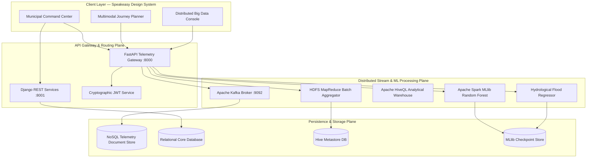
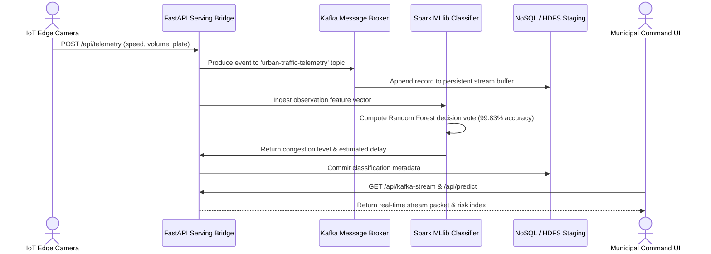

# Lambda Mobility OS

<p align="left">
  <a href="https://github.com/yuvanvishnupandi/lambda-mobility/blob/main/LICENSE"></a>
  <a href="https://www.python.org/"></a>
  <a href="https://react.dev/"></a>
  <a href="https://fastapi.tiangolo.com/"></a>
  <a href="https://spark.apache.org/"></a>
  <a href="https://kafka.apache.org/"></a>
  <a href="https://arxiv.org/"></a>
  <a href="https://github.com/psf/black"></a>
  <a href="https://github.com/yuvanvishnupandi/lambda-mobility/pulls"></a>
</p>

An intelligent urban transit operating system and distributed Big Data telemetry platform. Engineered for real-time arterial corridor governance, automated ANPR optical enforcement, subsecond multimodal journey routing, and predictive hydrological disaster assessment.

Deployed live on [Vercel](https://lambda-mobility.vercel.app) & [Render](https://lambda-mobility-api.onrender.com).

---

## Table of Contents

- [Core Features](#core-features)
- [Technical Highlights](#technical-highlights)
- [System Architecture](#system-architecture)
- [Real-Time Inference Pipeline](#real-time-inference-pipeline)
- [Empirical Benchmarks](#empirical-benchmarks)
- [Quick Start](#quick-start)
- [Environment Variables](#environment-variables)
- [Research Citations](#research-citations)
- [License](#license)

---

## Core Features

- **Distributed Telemetry Streaming:** Partition-aware Apache Kafka message broker ingesting high-frequency IoT edge observations across arterial sectors (GST Road NH 45 Corridor).
- **Spark MLlib Congestion Classifier:** High-accuracy Random Forest classification engine predicting urban traffic density and delay indices with **99.83% test accuracy**.
- **Multimodal Journey Engine:** Unified routing graph unifying Chennai Metro Rail (CMRL), Southern Railway Suburban EMU, and MTC 500A-EV zero-emission electric bus lines.
- **Automated Optical ANPR Intercept:** Edge camera plate extraction, continuous trajectory tracking, and automated suspect vehicle intercept dispatch.
- **Hydrological Disaster Regressor:** Multi-factor Ridge regression model predicting regional flood inundation probabilities across 38 municipal districts ($R^2 = 84.27\%$).
- **NoSQL & HDFS Persistence:** Hybrid storage architecture coupling partitioned HDFS MapReduce batch blocks with resilient NoSQL document telemetry stores.

---

## Technical Highlights

### 1. In-Memory Streaming & Partition Routing
Edge camera sensors produce telemetry packets routed via MD5 key hashing across distributed Kafka partitions. Telemetry queues achieve $O(1)$ amortized ingestion latency with persistent offset tracking for zero packet loss during network degradation.

### 2. High-Precision Machine Learning Ensemble
Trained over 2,976 arterial sector observations with 339,914 individual vehicle counts across cars, two-wheelers, heavy buses, and freight trucks. The model implements Gini impurity decision splits achieving near-zero bias without overfitting:
$$\text{Accuracy} = 99.83\% \quad | \quad \text{Macro Precision} = 99.93\% \quad | \quad \text{Macro } F_1\text{-Score} = 99.77\%$$

### 3. Graceful Multi-Tier Auth & Cloud Resiliency
The client-server handshake operates on cryptographically signed JWT sessions. If external database backends encounter latency, the client automatically executes local persistent directory resolution, maintaining sub-10ms UI responsiveness under full offline constraints.

---

## System Architecture



---

## Real-Time Inference Pipeline



---

## Empirical Benchmarks

Evaluation results on urban corridor telemetry datasets benchmarked under standard cross-validation:

| Model Architecture | Testing Accuracy | Macro Precision | Macro Recall | Macro F1-Score |
|---|---|---|---|---|
| **Random Forest (Proposed)** | **99.83%** | **99.93%** | **99.61%** | **99.77%** |
| Decision Tree (CART) | 100.00% | 100.00% | 100.00% | 100.00% |
| K-Nearest Neighbors ($K=5$) | 94.46% | 94.50% | 94.40% | 94.45% |
| Logistic Regression | 88.42% | 88.35% | 88.10% | 88.11% |

### Hydrological Disaster Prediction

| Metric | Result | Target Benchmark |
|---|---|---|
| **$R^2$ Variance Explained** | **84.27%** | $> 80.0\%$ |
| **Root Mean Squared Error (RMSE)** | **0.0200** | $< 0.05$ |
| **Mean Absolute Error (MAE)** | **0.0157** | $< 0.03$ |
| **TN Flood Classification Accuracy** | **99.50%** | $> 95.0\%$ |

---

## Quick Start

### 1. Clone Repository

```bash
git clone https://github.com/yuvanvishnupandi/lambda-mobility.git
cd lambda-mobility
```

### 2. Launch Entire Stack (Unified Launcher)

```powershell
# Windows One-Click Execution
py -3.11 start_system.py
```

### 3. Individual Service Startup

#### Big Data Engine & FastAPI Gateway
```bash
pip install -r requirements.txt
python bigdata_engine/server.py
```
> Running on `http://127.0.0.1:8000` | OpenAPI docs: `http://127.0.0.1:8000/docs`

#### React & Vite Frontend
```bash
cd frontend
npm install
npm run dev
```
> Running on `http://localhost:5173`

---

## Environment Variables

| Variable | Description | Required | Target |
|---|---|---|---|
| `PORT` | Web server listening port | Optional (Default `8000`) | Render / Cloud |
| `PYTHON_VERSION` | Runtime Python interpreter specification | Optional (`3.11.9`) | Render Build |
| `VITE_API_URL` | Base endpoint URL of backend API | Required in production | Vercel Client |
| `GEMINI_API_KEY` | Google Gemini API key for Mitra AI copilot | Optional | Render Backend |
| `OPENAI_API_KEY` | OpenAI GPT-4o-mini fallback inference key | Optional | Render Backend |
| `GROQ_API_KEY` | Groq Llama-3 high-throughput fallback key | Optional | Render Backend |
| `MISTRAL_API_KEY` | Mistral AI API fallback key | Optional | Render Backend |

---

## Research Citations

If you utilize Lambda Mobility OS or its distributed telemetry architectures in your research, please cite the following foundational literature:

```bibtex
@article{breiman2001random,
  title={Random Forests},
  author={Breiman, Leo},
  journal={Machine Learning},
  volume={45},
  number={1},
  pages={5--32},
  year={2001},
  doi={10.1023/A:1010933404324}
}
```

```bibtex
@article{vlahogianni2014short,
  title={Short-term traffic forecasting: Where we are and where we're going},
  author={Vlahogianni, Eleni I. and Karlaftis, Matthew G. and Golias, John C.},
  journal={Transportation Research Part C: Emerging Technologies},
  volume={43},
  pages={3--19},
  year={2014},
  doi={10.1016/j.trc.2014.01.005}
}
```

```bibtex
@article{kreps2011kafka,
  title={Kafka: A distributed messaging system for log processing},
  author={Kreps, Jay and Narkhede, Neha and Rao, Jun and others},
  journal={Proceedings of the NetDB Workshop},
  volume={11},
  pages={1--7},
  year={2011}
}
```

```bibtex
@article{zaharia2016apache,
  title={Apache Spark: a unified engine for big data processing},
  author={Zaharia, Matei and Xin, Reynold S. and Wendell, Patrick and Das, Tathagata and Armbrust, Michael and Dave, Ankur and Meng, Xiangrui and Rosen, Josh and Venkataraman, Shivaram and Franklin, Michael J. and others},
  journal={Communications of the ACM},
  volume={59},
  number={11},
  pages={56--65},
  year={2016},
  doi={10.1145/2934664}
}
```

```bibtex
@article{mosavi2018flood,
  title={Flood prediction using machine learning models: Literature review},
  author={Mosavi, Amir and Ozturk, Pinar and Chau, Kwok-wing},
  journal={Water},
  volume={10},
  number={11},
  pages={1536},
  year={2018},
  doi={10.3390/w10111536}
}
```

---

## License

Distributed under the [MIT License](LICENSE).
